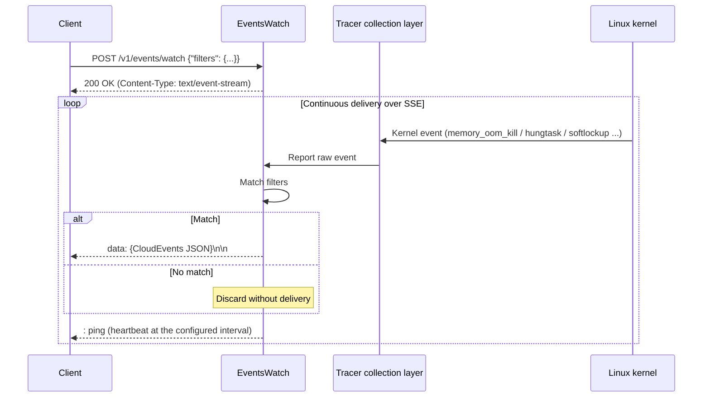

## Overview

`/v1/events/watch` is HUATUO's real-time kernel event subscription interface. A client opens one persistent HTTP POST connection to receive abnormal kernel events from a node. Events use [CloudEvents 1.0](https://cloudevents.io/) envelopes and are delivered through [Server-Sent Events (SSE)](https://html.spec.whatwg.org/multipage/server-sent-events.html).

## Use Cases

| Goal | Approach |
| --- | --- |
| Integrate with alerting or diagnostic platforms | Subscribe by node, namespace, and event type; assess impact alongside application metrics |
| Record a timeline of anomalies | Write events to a message queue or storage for later queries |
| Validate test scenarios | Observe target events and context during load tests or fault injection |

Subscription results are diagnostic evidence. They do not guarantee coverage of every anomaly and cannot alone justify restarts, isolation, or scaling.

## Server Configuration

Configure event streaming in the `[HTTPServer]` section of the HUATUO configuration:

```toml
[HTTPServer]
    # Maximum concurrent clients; new connections above this limit receive HTTP 429
    # Default: 100
    MaxEventStreamClients = 100

    # SSE heartbeat interval in seconds, preventing proxy/load-balancer idle timeouts
    # Close a client connection after 3 consecutive heartbeat write failures
    # Default: 30
    EventStreamKeepAliveIntervalSeconds = 30
```

| Setting | Default | Description |
|---|---|---|
| `MaxEventStreamClients` | 100 | Maximum persistent `/v1/events/watch` connections; excess connections receive HTTP 429 |
| `EventStreamKeepAliveIntervalSeconds` | 30 | Heartbeat interval; keep it below the upstream proxy's idle timeout |

## Subscription API

### Endpoint

```http
POST /v1/events/watch
```

### Request Headers

```http
Authorization: Bearer <node-token>
Content-Type: application/json
```

### Request Body

```json
{
  "filters": {
    "tracer_name": "<regex>",
    "hostname": "<regex>",
    "container_hostname": "<regex>",
    "container_host_namespace": "<regex>",
    "container_qos": "<regex>",
    "region": "<regex>"
  }
}
```

**Filter fields:**

| Field | Type | Required | Description |
|----------------------------|------|--------|----------------------------------------------|
| `tracer_name` | string | No | Filter by collector name; supports regular expressions |
| `hostname` | string | No | Filter by node hostname; supports regular expressions |
| `container_hostname` | string | No | Filter by container hostname; supports regular expressions |
| `container_host_namespace` | string | No | Filter by container namespace; supports regular expressions |
| `container_qos` | string | No | Filter by container QoS; supports regular expressions |
| `region` | string | No | Filter by region; supports regular expressions |

- All filter fields are optional; omitted or empty fields match all values.
- Multiple fields must **all match** (AND semantics).
- Filters run on the server; only matching events are delivered.

### Response Format (SSE)

After establishing the connection, the server continuously sends SSE events:

```text
data: {"specversion":"1.0","id":"...","source":"/huatuo/node-1/memory_oom_kill",...}\n\n
```

The server also sends periodic heartbeat comment lines to keep the connection alive:

```text
: ping\n
```

## curl Examples

### Subscribe to All Kernel Events

```bash
curl -s -N -X POST http://<node-ip>:19704/v1/events/watch \
  -H "Authorization: Bearer <node-token>" \
  -H "Content-Type: application/json" \
  -H "Accept: text/event-stream" \
  -H "Cache-Control: no-cache" \
  -H "Connection: keep-alive" \
  -d '{}'
```

### Subscribe to OOM Events

```bash
curl -s -N -X POST http://<node-ip>:19704/v1/events/watch \
  -H "Authorization: Bearer <node-token>" \
  -H "Content-Type: application/json" \
  -H "Accept: text/event-stream" \
  -H "Cache-Control: no-cache" \
  -H "Connection: keep-alive" \
  -d '{"filters": {"tracer_name": "^memory_oom_kill$"}}'
```

### Subscribe to Network Events on a Node

```bash
curl -s -N -X POST http://<node-ip>:19704/v1/events/watch \
  -H "Authorization: Bearer <node-token>" \
  -H "Content-Type: application/json" \
  -H "Accept: text/event-stream" \
  -H "Cache-Control: no-cache" \
  -H "Connection: keep-alive" \
  -d '{
    "filters": {
      "hostname": "^node-1$",
      "tracer_name": "netdev|dropwatch|net_rx_latency"
    }
  }'
```

### Subscribe to Container Events in the prod Namespace

```bash
curl -s -N -X POST http://<node-ip>:19704/v1/events/watch \
  -H "Authorization: Bearer <node-token>" \
  -H "Content-Type: application/json" \
  -H "Accept: text/event-stream" \
  -H "Cache-Control: no-cache" \
  -H "Connection: keep-alive" \
  -d '{
    "filters": {
      "container_host_namespace": "^prod$"
    }
  }'
```

> **Note:** `-N` disables curl buffering so SSE events appear immediately in the terminal.

## Event Format

### CloudEvents Fields

Each delivered event is a JSON object conforming to CloudEvents 1.0:

| Field | Type | Description |
|-------------------|------|---------------------------------------------------------|
| `specversion` | string | Always `"1.0"` |
| `id` | string | Unique event ID (UUID v4), generated independently for each event |
| `source` | string | Event source path: `/huatuo/{hostname}/{tracer_name}` |
| `type` | string | Always `"tech.huatuo.kernel.event"` |
| `datacontenttype` | string | Always `"application/json"` |
| `time` | string | Event collection time (RFC 3339, nanosecond precision, UTC) |
| `data` | object | Event body, the `WatchEventData` structure |

### Event Data

The `data` field contains a standard HUATUO event record:

```json
{
  "specversion": "1.0",
  "id": "f47ac10b-58cc-4372-a567-0e02b2c3d479",
  "source": "/huatuo/node-1/memory_oom_kill",
  "type": "tech.huatuo.kernel.event",
  "datacontenttype": "application/json",
  "time": "2026-05-18T10:23:45.123456789Z",
  "data": {
    "hostname": "node-1",
    "region": "cn-beijing",
    "observed_timestamp": "2026-05-18T10:23:45Z",
    "tracer_name": "memory_oom_kill",
    "tracer_id": "abc123",
    "tracer_run_type": "auto",
    "container_id": "d3f1a2b4c5e6",
    "container_hostname": "app-pod",
    "container_host_namespace": "prod",
    "container_type": "docker",
    "container_qos": "guaranteed"
  }
}
```

**WatchEventData fields:**

| Field | Type | Description |
|----------------------------|------|---------------------------------------------|
| `hostname` | string | Node hostname |
| `region` | string | Node region |
| `observed_timestamp` | string | UTC time when the producer observes the event in user space |
| `kernel_observed_timestamp` | string | Optional kernel observation time in UTC |
| `tracer_name` | string | Collector that triggered the event (see the event types below) |
| `tracer_id` | string | Unique event instance ID |
| `tracer_run_type` | string | Collection mode: `auto` (automatically triggered) or `manual` |
| `container_id` | string | Container ID, present for container-level events |
| `container_hostname` | string | Container hostname |
| `container_host_namespace` | string | Container namespace |
| `container_type` | string | Container runtime type, such as docker or containerd |
| `container_qos` | string | Container QoS class |

## Event Types

| `tracer_name` | Description |
|--------------------------|-----------------------------------------------|
| `memory_oom_kill` | Out-of-memory (OOM Killer) events |
| `hungtask` | Kernel detection of tasks in prolonged D state |
| `softlockup` | CPU soft lockup detection |
| `ras` | Hardware reliability (RAS) errors, such as ECC memory errors |
| `dropwatch` | Kernel packet drop events |
| `netdev_events` | Network device state changes, such as Link Up/Down |
| `netdev_txqueue_timeout` | Network device transmit queue timeouts |
| `netdev_bonding_lacp` | Bond device LACP protocol anomalies |
| `net_rx_latency` | Abnormal network receive latency |
| `sched_tick` | Abnormal scheduling tick intervals |
| `memory_reclaim_events` | Memory reclaim anomalies |
| `cpuidle` | Abnormal CPU idle utilization (triggered by AutoTracing) |
| `cpusys` | Abnormal system-mode CPU utilization (triggered by AutoTracing) |
| `dload` | Abnormal system load (triggered by AutoTracing) |
| `iotracing` | Abnormal I/O latency (triggered by AutoTracing) |
| `memburst` | Memory usage bursts (triggered by AutoTracing) |

## Go Client

`POST /v1/events/watch` is included in the Node OpenAPI contract. This example uses the generated request types, event types, and client directly.

```go
package main

import (
	"bufio"
	"context"
	"encoding/json"
	"fmt"
	"log/slog"
	"net/http"
	"os"
	"strings"
	"time"

	nodeapi "github.com/ccfos/huatuo/apis/v1/node"
)

func watchEvents(
	ctx context.Context,
	baseURL string,
	token string,
	filters nodeapi.WatchEventFilters,
) error {
	client, err := nodeapi.NewClient(
		baseURL,
		nodeapi.WithHTTPClient(&http.Client{}),
		nodeapi.WithRequestEditorFn(func(_ context.Context, request *http.Request) error {
			request.Header.Set("Authorization", "Bearer "+token)
			request.Header.Set("Accept", "text/event-stream")
			return nil
		}),
	)
	if err != nil {
		return fmt.Errorf("create Node API client: %w", err)
	}
	resp, err := client.WatchEvents(ctx, nodeapi.WatchEventsJSONRequestBody{
		Filters: &filters,
	})
	if err != nil {
		return fmt.Errorf("connect: %w", err)
	}
	defer resp.Body.Close()

	if resp.StatusCode != http.StatusOK {
		return fmt.Errorf("unexpected status: %d", resp.StatusCode)
	}

	scanner := bufio.NewScanner(resp.Body)
	for scanner.Scan() {
		line := scanner.Text()

		// Skip heartbeat comments and empty lines.
		if line == "" || strings.HasPrefix(line, ":") {
			continue
		}

		// SSE data line format: `data: <json>`
		data, ok := strings.CutPrefix(line, "data: ")
		if !ok {
			continue
		}

		var event nodeapi.WatchEvent
		if err := json.Unmarshal([]byte(data), &event); err != nil {
			slog.Warn("parse event", "err", err)
			continue
		}

		fmt.Printf(
			"[%s] source=%s id=%s\n",
			event.Time.Format(time.RFC3339Nano),
			event.Source,
			event.ID.String(),
		)
		fmt.Printf("  data: %+v\n", event.Data)
	}

	return scanner.Err()
}

func main() {
	ctx, cancel := context.WithTimeout(context.Background(), 5*time.Minute)
	defer cancel()

	tracerName := "memory_oom_kill|hungtask|softlockup"
	err := watchEvents(ctx, "http://192.168.1.10:19704", "node-token", nodeapi.WatchEventFilters{
		TracerName: &tracerName,
	})
	if err != nil {
		slog.Error("watch events", "err", err)
		os.Exit(1)
	}
}
```

### Choose a Streaming Client

Use the generated `Client.WatchEvents` method to obtain an `http.Response` directly. Do not use `ClientWithResponses.WatchEventsWithResponse` for this endpoint: it reads the response body until EOF, while an SSE connection normally remains open until the caller cancels its context.

### Reconnect After Disconnection

Network interruptions or service restarts can disconnect clients in production. Add reconnection logic with exponential backoff:

```go
func watchWithRetry(
	ctx context.Context,
	baseURL string,
	token string,
	filters nodeapi.WatchEventFilters,
) {
	backoff := time.Second
	for {
		if err := watchEvents(ctx, baseURL, token, filters); err != nil {
			if ctx.Err() != nil {
				return
			}
			slog.Warn("disconnected, retrying", "err", err, "backoff", backoff)
			// time.NewTimer + Stop releases timer resources immediately on context cancellation.
			timer := time.NewTimer(backoff)
			select {
			case <-ctx.Done():
				timer.Stop()
				return
			case <-timer.C:
			}
			if backoff < 30*time.Second {
				backoff *= 2
			}
		}
	}
}
```

## How It Works

The client keeps its SSE connection open after the POST request. The node collects kernel events, filters them by subscription, and sends matching events in CloudEvents envelopes without client polling. Heartbeats follow the configured interval. Delivery latency depends on collection, processing, and network conditions.


