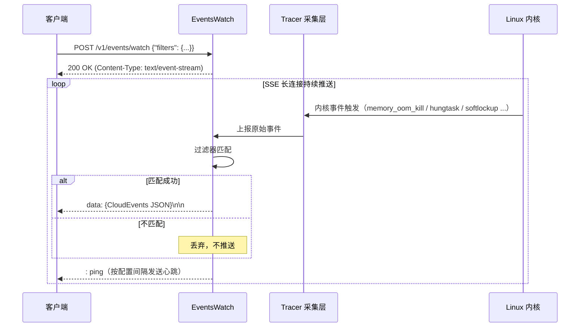

## 概述

`/v1/events/watch` 是华佗（HUATUO）提供的实时内核事件订阅接口。客户端通过一次 HTTP POST 长连接即可持续接收节点上发生的内核异常事件。事件以 [CloudEvents 1.0](https://cloudevents.io/) 规范封装，通过 [Server-Sent Events（SSE）](https://html.spec.whatwg.org/multipage/server-sent-events.html) 协议推送。

## 适用场景

| 目标 | 使用方式 |
| --- | --- |
| 接入告警或诊断平台 | 按节点、命名空间和事件类型订阅，并结合业务指标判断影响 |
| 记录异常时间线 | 将事件写入消息队列或存储，供后续查询 |
| 验证测试场景 | 在压测或故障注入期间观察目标事件及其上下文 |

订阅结果是诊断线索，不保证覆盖全部异常，也不能单独作为重启、隔离或扩容的依据。

## 服务配置

在华佗配置文件的 `[HTTPServer]` 段配置事件流参数：

```toml
[HTTPServer]
    # 最大并发客户端连接数，超出后新连接返回 HTTP 429
    # Default: 100
    MaxEventStreamClients = 100

    # SSE 心跳间隔（秒），防止代理/负载均衡因空闲而断开连接
    # 连续 3 次心跳写入失败则主动关闭该客户端连接
    # Default: 30
    EventStreamKeepAliveIntervalSeconds = 30
```

| 配置项 | 默认值 | 说明 |
|---|---|---|
| `MaxEventStreamClients` | 100 | `/v1/events/watch` 长连接上限，超出返回 HTTP 429 |
| `EventStreamKeepAliveIntervalSeconds` | 30 | 心跳间隔，应小于上游代理的 idle timeout |

## 订阅接口

### 接口地址

```http
POST /v1/events/watch
```

### 请求头

```http
Authorization: Bearer <node-token>
Content-Type: application/json
```

### 请求体结构

```json
{
  "filters": {
    "tracer_name": "<regex>",
    "hostname": "<regex>",
    "container_hostname": "<regex>",
    "container_host_namespace": "<regex>",
    "container_qos": "<regex>",
    "region": "<regex>"
  }
}
```

**filters 字段说明：**

| 字段                         | 类型   | 是否必填 | 说明                                         |
|----------------------------|------|--------|----------------------------------------------|
| `tracer_name`              | string | 否     | 按采集器名称过滤，支持正则表达式               |
| `hostname`                 | string | 否     | 按节点主机名过滤，支持正则表达式               |
| `container_hostname`       | string | 否     | 按容器主机名过滤，支持正则表达式               |
| `container_host_namespace` | string | 否     | 按容器命名空间过滤，支持正则表达式             |
| `container_qos`            | string | 否     | 按容器 QoS 过滤，支持正则表达式                |
| `region`                   | string | 否     | 按地域过滤，支持正则表达式                     |

- 所有过滤字段均为可选；省略或留空表示匹配所有值。
- 多个字段同时指定时，所有条件须**同时满足**（AND 语义）。
- 过滤器在服务端生效，仅匹配的事件才会推送到客户端。

### 响应格式（SSE 流）

连接建立后，服务端以 SSE 格式持续推送事件：

```text
data: {"specversion":"1.0","id":"...","source":"/huatuo/node-1/memory_oom_kill",...}\n\n
```

服务端还会定期发送心跳注释行以保持连接：

```text
: ping\n
```

## curl 示例

### 订阅所有内核事件

```bash
curl -s -N -X POST http://<node-ip>:19704/v1/events/watch \
  -H "Authorization: Bearer <node-token>" \
  -H "Content-Type: application/json" \
  -H "Accept: text/event-stream" \
  -H "Cache-Control: no-cache" \
  -H "Connection: keep-alive" \
  -d '{}'
```

### 只订阅 OOM 事件

```bash
curl -s -N -X POST http://<node-ip>:19704/v1/events/watch \
  -H "Authorization: Bearer <node-token>" \
  -H "Content-Type: application/json" \
  -H "Accept: text/event-stream" \
  -H "Cache-Control: no-cache" \
  -H "Connection: keep-alive" \
  -d '{"filters": {"tracer_name": "^memory_oom_kill$"}}'
```

### 订阅指定节点的网络类事件

```bash
curl -s -N -X POST http://<node-ip>:19704/v1/events/watch \
  -H "Authorization: Bearer <node-token>" \
  -H "Content-Type: application/json" \
  -H "Accept: text/event-stream" \
  -H "Cache-Control: no-cache" \
  -H "Connection: keep-alive" \
  -d '{
    "filters": {
      "hostname": "^node-1$",
      "tracer_name": "netdev|dropwatch|net_rx_latency"
    }
  }'
```

### 订阅 prod 命名空间的容器事件

```bash
curl -s -N -X POST http://<node-ip>:19704/v1/events/watch \
  -H "Authorization: Bearer <node-token>" \
  -H "Content-Type: application/json" \
  -H "Accept: text/event-stream" \
  -H "Cache-Control: no-cache" \
  -H "Connection: keep-alive" \
  -d '{
    "filters": {
      "container_host_namespace": "^prod$"
    }
  }'
```

> **说明：** `-N` 参数禁用 curl 缓冲，使 SSE 事件即时输出到终端。

## 事件格式

### CloudEvents 字段

每条推送事件均为一个符合 CloudEvents 1.0 规范的 JSON 对象：

| 字段                | 类型   | 说明                                                    |
|-------------------|------|---------------------------------------------------------|
| `specversion`     | string | 固定值 `"1.0"`                                          |
| `id`              | string | 事件唯一标识符（UUID v4），每条事件独立生成                |
| `source`          | string | 事件来源路径，格式 `/huatuo/{hostname}/{tracer_name}`    |
| `type`            | string | 固定值 `"tech.huatuo.kernel.event"`                     |
| `datacontenttype` | string | 固定值 `"application/json"`                             |
| `time`            | string | 事件采集时间（RFC 3339 纳秒精度，UTC）                   |
| `data`            | object | 事件数据体，即 `WatchEventData` 结构体                   |

### 事件数据

`data` 字段包含华佗的标准事件记录：

```json
{
  "specversion": "1.0",
  "id": "f47ac10b-58cc-4372-a567-0e02b2c3d479",
  "source": "/huatuo/node-1/memory_oom_kill",
  "type": "tech.huatuo.kernel.event",
  "datacontenttype": "application/json",
  "time": "2026-05-18T10:23:45.123456789Z",
  "data": {
    "hostname": "node-1",
    "region": "cn-beijing",
    "observed_timestamp": "2026-05-18T10:23:45Z",
    "tracer_name": "memory_oom_kill",
    "tracer_id": "abc123",
    "tracer_run_type": "auto",
    "container_id": "d3f1a2b4c5e6",
    "container_hostname": "app-pod",
    "container_host_namespace": "prod",
    "container_type": "docker",
    "container_qos": "guaranteed"
  }
}
```

**WatchEventData 字段说明：**

| 字段                         | 类型   | 说明                                        |
|----------------------------|------|---------------------------------------------|
| `hostname`                 | string | 节点主机名                                  |
| `region`                   | string | 节点所在地域                                |
| `observed_timestamp`       | string | 事件生产者在用户态观测事件的 UTC 时间          |
| `kernel_observed_timestamp` | string | 可选；内核观测事件的 UTC 时间 |
| `tracer_name`              | string | 触发事件的采集器名称（见下文内核事件列表）   |
| `tracer_id`                | string | 事件实例唯一 ID                             |
| `tracer_run_type`          | string | 采集模式，`auto`（自动触发）或 `manual`     |
| `container_id`             | string | 容器 ID（容器级事件时存在）                 |
| `container_hostname`       | string | 容器主机名                                  |
| `container_host_namespace` | string | 容器所在命名空间                            |
| `container_type`           | string | 容器运行时类型（docker / containerd 等）    |
| `container_qos`            | string | 容器 QoS 等级                              |

## 事件类型

| `tracer_name`              | 说明                                           |
|--------------------------|-----------------------------------------------|
| `memory_oom_kill`                    | 内存不足（OOM Killer）触发事件                  |
| `hungtask`               | 内核任务长时间 D 状态（Hung Task）检测          |
| `softlockup`             | CPU 软锁死（Soft Lockup）检测                  |
| `ras`                    | 硬件可靠性（RAS）错误，如 ECC 内存错误         |
| `dropwatch`              | 内核网络数据包丢弃（Drop Watch）事件            |
| `netdev_events`          | 网络设备状态变更事件（Link Up/Down 等）        |
| `netdev_txqueue_timeout` | 网络设备发送队列超时事件                        |
| `netdev_bonding_lacp`    | Bond 设备 LACP 协议异常事件                    |
| `net_rx_latency`         | 网络接收延迟异常事件                            |
| `sched_tick`             | 调度 tick 间隔异常追踪事件                     |
| `memory_reclaim_events`  | 内存回收异常事件                               |
| `cpuidle`                | CPU 空闲率异常（AutoTracing 自动触发）         |
| `cpusys`                 | CPU 系统态占用率异常（AutoTracing 自动触发）   |
| `dload`                  | 系统负载异常（AutoTracing 自动触发）           |
| `iotracing`              | I/O 延迟异常（AutoTracing 自动触发）           |
| `io_health`              | Block、NVMe、SCSI 和 MD 健康事件               |
| `memburst`               | 内存突增异常（AutoTracing 自动触发）           |

## Go 客户端

`POST /v1/events/watch` 已纳入 Node OpenAPI 契约。以下示例直接使用生成的
请求类型、事件类型和客户端。

```go
package main

import (
	"bufio"
	"context"
	"encoding/json"
	"fmt"
	"log/slog"
	"net/http"
	"os"
	"strings"
	"time"

	nodeapi "github.com/ccfos/huatuo/apis/v1/node"
)

func watchEvents(
	ctx context.Context,
	baseURL string,
	token string,
	filters nodeapi.WatchEventFilters,
) error {
	client, err := nodeapi.NewClient(
		baseURL,
		nodeapi.WithHTTPClient(&http.Client{}),
		nodeapi.WithRequestEditorFn(func(_ context.Context, request *http.Request) error {
			request.Header.Set("Authorization", "Bearer "+token)
			request.Header.Set("Accept", "text/event-stream")
			return nil
		}),
	)
	if err != nil {
		return fmt.Errorf("create Node API client: %w", err)
	}
	resp, err := client.WatchEvents(ctx, nodeapi.WatchEventsJSONRequestBody{
		Filters: &filters,
	})
	if err != nil {
		return fmt.Errorf("connect: %w", err)
	}
	defer resp.Body.Close()

	if resp.StatusCode != http.StatusOK {
		return fmt.Errorf("unexpected status: %d", resp.StatusCode)
	}

	scanner := bufio.NewScanner(resp.Body)
	for scanner.Scan() {
		line := scanner.Text()

		// 跳过心跳注释行和空行
		if line == "" || strings.HasPrefix(line, ":") {
			continue
		}

		// SSE data 行格式：`data: <json>`
		data, ok := strings.CutPrefix(line, "data: ")
		if !ok {
			continue
		}

		var event nodeapi.WatchEvent
		if err := json.Unmarshal([]byte(data), &event); err != nil {
			slog.Warn("parse event", "err", err)
			continue
		}

		fmt.Printf(
			"[%s] source=%s id=%s\n",
			event.Time.Format(time.RFC3339Nano),
			event.Source,
			event.ID.String(),
		)
		fmt.Printf("  data: %+v\n", event.Data)
	}

	return scanner.Err()
}

func main() {
	ctx, cancel := context.WithTimeout(context.Background(), 5*time.Minute)
	defer cancel()

	tracerName := "memory_oom_kill|hungtask|softlockup"
	err := watchEvents(ctx, "http://192.168.1.10:19704", "node-token", nodeapi.WatchEventFilters{
		TracerName: &tracerName,
	})
	if err != nil {
		slog.Error("watch events", "err", err)
		os.Exit(1)
	}
}
```

### 流式客户端选择

应使用生成的 `Client.WatchEvents` 方法直接获取 `http.Response`。不要对该接口使用
`ClientWithResponses.WatchEventsWithResponse`：后者会读取响应体直到 EOF，而 SSE
连接通常会持续到调用方取消 context。

### 断线重连

生产环境中，网络抖动或服务重启会导致连接断开，建议加入指数退避重连逻辑：

```go
func watchWithRetry(
	ctx context.Context,
	baseURL string,
	token string,
	filters nodeapi.WatchEventFilters,
) {
	backoff := time.Second
	for {
		if err := watchEvents(ctx, baseURL, token, filters); err != nil {
			if ctx.Err() != nil {
				return
			}
			slog.Warn("disconnected, retrying", "err", err, "backoff", backoff)
			// time.NewTimer + Stop 确保 context 取消时计时器资源立即释放
			timer := time.NewTimer(backoff)
			select {
			case <-ctx.Done():
				timer.Stop()
				return
			case <-timer.C:
			}
			if backoff < 30*time.Second {
				backoff *= 2
			}
		}
	}
}
```

## 实现原理

客户端发起 POST 请求后保持 SSE 连接。节点采集内核事件，按订阅条件过滤，再将匹配事件封装为 CloudEvents 推送给客户端，无需轮询。连接按配置间隔发送心跳；事件送达延迟取决于采集、处理和网络状态。


