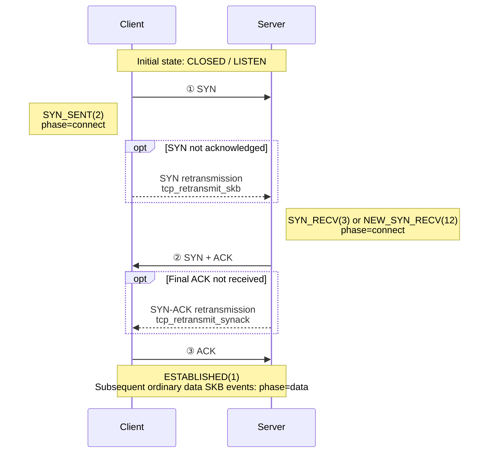

## Overview

`tcpshark --mode retransmit` observes TCP retransmission activity through the kernel tracepoints `tcp/tcp_retransmit_skb` and `tcp/tcp_retransmit_synack`. Explicitly enabling TLP also attaches a `tcp_send_loss_probe` kprobe. Depending on the event type, records can include IP four-tuples, TCP state, congestion-control state, retransmission counters, sequence information, and socket metadata for container attribution.

The user-space classifier derives connection phases and reason labels from the event type, `sk_state`, `ca_state`, and reordering counters. These labels are operational heuristics, not conclusive evidence of a packet-drop cause.

`internal/pcapfilter` compiles filters at load time for execution in the kernel. With or without local correlation, the SKB, SYN-ACK, and TLP hooks filter the same synthetic L3 TCP packet representation. Protocol, address, network, and port conditions are supported; Ethernet addresses, payloads, actual packet lengths, IP/TCP options, and raw byte-offset semantics are not. Safe EtherType checks such as `ether proto ip` are compiled using the raw-IP layout. A pair of IPv4-mapped IPv6 socket addresses is filtered as IPv4; the raw perf record retains AF_INET6, and user space normalizes addresses before matching. Local correlation applies the identical expression to embedded dropwatch. Use a direction-symmetric expression to retain reverse ACK or SYN-ACK evidence.

## Use Cases

### Retransmission Diagnosis

Observe RTO, fast retransmission, reordering-related retransmission, and TLP events over time to identify abnormal retransmissions during connection establishment, data transfer, and closure. These observations help investigate packet loss, congestion, reordering, or unreachable peers.

### Container Networking

Use container IDs, network namespaces, and socket cgroup metadata to locate affected workloads. Focus on a service with `--filter "tcp and port <service-port>"` to reduce interference from other host connections.

### Latency and Throughput

Align retransmission events with application latency, error rates, and throughput to determine whether RTOs or repeated retransmissions coincide with degraded performance. This helps distinguish slower application processing from network anomalies.

### Drop Correlation

Local mode correlates retransmissions and drops within one tcpshark process. Matching checks network namespace, tuple direction, TCP sequence or ACK evidence, and kernel monotonic time ordering. A strict match identifies drop evidence satisfying all correlation conditions; its software or hardware source comes from the record. No match remains `unknown`, because source readiness does not prove that earlier causal history was observed.

## Run tcpshark

```text
tcpshark --mode retransmit [flags]
```

| Flag | Default | Description |
|------|--------|------|
| `--mode retransmit` | Required | Select TCP retransmission tracing. |
| `--enable-tlp`, `--tlp` | Disabled | Also attach `tcp_send_loss_probe` and emit TLP events. |
| `--bpf-path <path>` | Required without correlation | Path to a single `tcp_retransmit.o` file. |
| `--bpf-path-dir <dir>` | Required with correlation | Directory containing both `tcp_retransmit.o` and `net_dropwatch.o`. |
| `--with-dropwatch` | Disabled | Load embedded dropwatch and correlate its events with retransmissions. |
| `--filter <expr>` | None | L3-compatible tcpdump-style filter shared by the three retransmission hooks and, in local mode, embedded dropwatch; see "Filter Expressions." |
| `--device <names>` | None | Comma-separated device allowlist, as in dropwatch; filters embedded dropwatch only and requires `--with-dropwatch`. |
| `--device-excluded <names>` | None | Device denylist, mutually exclusive with `--device`; requires `--with-dropwatch`. |
| `--duration <n>` | 0 | Exit after N seconds; 0 runs until Ctrl-C. |
| `--max-events-per-second <n>` | 0 | BPF event rate limit; 0 is unlimited. |
| `--enable-pprof` | `false` | Expose the tool process's Go runtime profiles on `127.0.0.1:6000`. |
| `--output <json\|text>` | `text` | Output format; ignored when `--output-storage` is set. |
| `--output-storage <path>` | None | Send events to huatuo-bamai through a Unix socket. |
| `--task-id <id>` | None | Task ID for the toolstream session; must be used with `--output-storage`. |

If both `--output` and `--output-storage` are explicitly set, `--output` is ignored and a warning is printed.

pprof is disabled by default. Passing `--enable-pprof` enables it on `127.0.0.1:6000`; an occupied port fails startup. It profiles this tool process, not huatuo-bamai or the traced target.

### Common Commands

```bash
# Emit all retransmission-related events as text
sudo tcpshark --mode retransmit --bpf-path bpf/tcp_retransmit.o

# Emit NDJSON
sudo tcpshark --mode retransmit --bpf-path bpf/tcp_retransmit.o --output json

# Filter ordinary retransmission SKBs by destination host and port in BPF
sudo tcpshark --mode retransmit --bpf-path bpf/tcp_retransmit.o --filter "dst host 10.0.0.1 and dst port 443"

# Local correlation: both BPF inputs use the same direction-symmetric filter
sudo tcpshark --mode retransmit --with-dropwatch --bpf-path-dir bpf \
  --filter "tcp and port 443"

# Include Tail Loss Probe events (disabled by default)
sudo tcpshark --mode retransmit --enable-tlp --bpf-path bpf/tcp_retransmit.o

# Emit at most 100 events per second; log rate limit hit when exceeded
sudo tcpshark --mode retransmit --bpf-path bpf/tcp_retransmit.o \
  --max-events-per-second 100

# Filter all formatted event types in user space, retaining destination port 443
sudo tcpshark --mode retransmit --bpf-path bpf/tcp_retransmit.o --output json \
  | jq -c 'select(.tcp_dport == 443)'

# Run for 60 seconds and retain only events classified as RTO
sudo tcpshark --mode retransmit --bpf-path bpf/tcp_retransmit.o --duration 60 --output json \
  | jq -c 'select(.tcp_reason == "RTO")'

# Forward events to a running huatuo-bamai instance
sudo tcpshark --mode retransmit --bpf-path bpf/tcp_retransmit.o \
  --output-storage /var/run/huatuo-toolstream.sock
```

`jq -c` emits each result as one JSON line for NDJSON storage or further piping.

### huatuo-bamai Integration

tcpshark and dropwatch share the same `--output-storage` and toolstream flow. See the [dropwatch guide](/docs/best-practice/dropwatch_en.md) for general storage setup. TCP retransmission tracing adds these settings:

```toml
[EventTracing.TCPRetransmit]
    # Used by tcpshark in both modes; empty by default.
    Filter = ""

    # When true, pass tcpshark --enable-tlp; default: false.
    EnableTLP = false

    # Use embedded dropwatch; default: false.
    EnableDropwatch = false

    # Passed to tcpshark --max-events-per-second; default: 100, 0 means unlimited.
    MaxEventsPerSecond = 100
```

`EventTracing.TCPRetransmit.Filter` controls retransmission collection in both modes. With local correlation disabled, an empty value omits `--filter`. With correlation enabled, the normalized expression goes to both tcpshark inputs; an empty value becomes `tcp`. `EventTracing.Dropwatch.Filter` remains independent and controls only standalone dropwatch.

The `tcp_retransmit` tracer is in the global `BlackList` by default. Remove it and restart huatuo-bamai to enable it. Local correlation uses a private dropwatch source, so standalone `dropwatch` can remain blacklisted.

## Filter Expressions

tcpshark uses the same tcpdump-style filter expressions as dropwatch. See the [dropwatch guide](/docs/best-practice/dropwatch_en.md) for syntax, limitations, and further examples.

```bash
# A specific destination host and port
--filter "dst host 10.0.0.1 and dst port 443"

# Observe bidirectional traffic between two networks
--filter "(src net 10.10.0.0/16 and dst net 10.20.0.0/16) or (src net 10.20.0.0/16 and dst net 10.10.0.0/16)"
```

> In local mode, the same expression must cover both directions. Directional selectors can exclude reverse ACK or SYN-ACK drop evidence, weakening the available evidence.

> Both modes reject primitives depending on Ethernet addresses, such as `ether host 02:00:00:00:00:01`. `ether proto ip` and `ether proto ip6` are supported because they compile to raw-IP version checks.

## Event Fields

Each event is an NDJSON object (`types.TCPRetransmitTracing`). Fields tagged `omitempty` are omitted when empty or zero.

| Field | Type | Description |
|------|------|------|
| `observed_timestamp` | string | UTC time generated when user space receives/formats the event (RFC3339Nano), not kernel hook time. |
| `kernel_observed_timestamp` | string | Kernel observation time in UTC (RFC3339Nano), converted from raw monotonic time. |
| `comm` | string | Process name in the current kernel execution context; not necessarily the socket owner. |
| `pid` | uint64 | TGID of the current execution context; not necessarily the socket owner's TGID. |
| `container_id` | string | Container ID resolved by huatuo-bamai; see "Container ID Resolution." |
| `memory_cgroup_css_addr` | string | Hexadecimal socket memory cgroup CSS address for container attribution. |
| `net_namespace_cookie` | uint64 | Socket network namespace cookie for container attribution. |
| `net_namespace_inum` | uint32 | Socket network namespace inum for container attribution. |
| `tcp_saddr` | string | Source IP address. |
| `tcp_daddr` | string | Destination IP address. |
| `tcp_sport` | uint16 | Source port. |
| `tcp_dport` | uint16 | Destination port. |
| `tcp_state` | string | TCP socket state, such as `ESTABLISHED`, `SYN_SENT`, or `NEW_SYN_RECV`. |
| `phase` | string | Classification: `connect`, `data`, or `close`. |
| `tcp_reason` | string | Classification: `RTO`, `fast_retransmit`, `TLP`, or `unknown`. |
| `event_type` | string | `tcp_retransmit_skb`, `tcp_retransmit_synack`, or `tcp_send_loss_probe`. |
| `ca_state` | uint8 | Congestion-control state: 0=Open, 1=Disorder, 2=CWR, 3=Recovery, 4=Loss. |
| `icsk_retransmits` | uint8 | Current retransmission counter snapshot. |
| `icsk_pending` | uint8 | Raw pending-timer state in `inet_connection_sock`; see the values below. |
| `reord_seen` | uint32 | Cumulative reordering counter for the connection. |
| `dsack_dups` | uint32 | Cumulative DSACK duplicate counter. |
| `tcp_seq` | uint32 | SKB: `TCP_SKB_CB(skb)->seq`; TLP: `snd_nxt`; SYN-ACK: request `snt_isn` when available. |
| `tcp_ack_seq` | uint32 | SKB: `tcp_sk(sk)->rcv_nxt`; TLP: `snd_una`; SYN-ACK: request `rcv_nxt` when available. |
| `tcp_end_seq` | uint32 | SKB: `TCP_SKB_CB(skb)->end_seq`; SYN-ACK: request `snt_isn + 1` when available; omitted for TLP. |
| `tcp_flags` | string | Rendered TCP flags, such as `SYN\|ACK` or `ACK\|PSH`; from `TCP_SKB_CB(skb)->tcp_flags` for SKB events, derived from the event type for SYN-ACK, and omitted for TLP. |
| `skb_addr` | string | Hexadecimal retransmission-queue SKB pointer; absent for SYN-ACK and TLP events. |
| `drop_location` | string | Local correlation classification: `software`, `hardware`, or `unknown`. On a match, equals `drop_source`; unlike dropwatch, this is not a kernel address. |
| `drop_source` | string | Matched drop source: `software` or `hardware`; `unknown` for an unrecognized ABI source; omitted without a match. |
| `drop_reason` | string | As in dropwatch: BTF-resolved `SKB_DROP_REASON_*` for software drops, a decimal number if unresolved, or `NOT_SUPPORTED` on unsupported older kernels; devlink trap name for hardware drops. |
| `drop_reason_group` | string | Devlink trap group, such as `l2_drops`, for grouping hardware reasons; omitted for software drops and unmatched events. |
| `correlation_reason` | string | One terminal state: `matched`, `unsupported`, `warmup`, `wait_timeout`, `queue_full`, or `interrupted`; omitted when correlation is disabled. |
| `matched_net_namespace` | bool | A drop with the same namespace was observed in the same TCP flow, independently of packet and time checks. Always true for a strict match; omitted when false. |
| `drop_perf_status` | object | Embedded dropwatch cumulative counters for unmatched events. `map_counters_available` indicates whether map counters are usable; valid reader `lost_samples` remain available on read failure. |
| `drop_stack` | string | Stack of the matched drop; unmatched stacks are not symbolized. |
| `source` | string | `tools` when tcpshark runs independently; `events` when started by huatuo-bamai. |

`icsk_pending` is a snapshot of timer state at hook time, not a stable enum of retransmission reasons. TLP classification uses the explicit `event_type=tcp_send_loss_probe`, not `icsk_pending=5`.

| Value | Kernel State | Meaning |
|---:|----------|------|
| `0` | None | No pending transmit-timer event. |
| `1` | `ICSK_TIME_RETRANS` | Retransmission timeout (RTO) timer. |
| `2` | `ICSK_TIME_DACK` | Delayed ACK. Modern kernels store this in `icsk_ack.pending` and use a separate delayed-ACK timer, so it normally does not appear in `icsk_pending`. |
| `3` | `ICSK_TIME_PROBE0` | Zero-window probe timer. |
| `4` | Version-dependent | No longer defined in current mainline kernels. Older kernels used it for Early Retransmit, and earlier kernels for Keepalive. |
| `5` | `ICSK_TIME_LOSS_PROBE` | Tail Loss Probe (TLP) timer. |
| `6` | `ICSK_TIME_REO_TIMEOUT` | Reordering timeout, primarily for RACK loss detection. |

### Text Output

Text output uses a terminal-readable layout with the same event variables as JSON. Optional variables appear only when nonzero or nonempty, and strings have no JSON quoting or escaping. For compatibility, `state`, `skb`, `seq`, `end`, `ack`, `flags`, `ca`, `retrans`, and `reason` correspond to JSON fields `tcp_state`, `skb_addr`, `tcp_seq`, `tcp_end_seq`, `tcp_ack_seq`, `tcp_flags`, `ca_state`, `icsk_retransmits`, and `correlation_reason`, respectively.

```text
<timestamp> [<phase>/<tcp_reason>] <saddr>:<sport> > <daddr>:<dport> state=<STATE> event_type=<TYPE> [kernel_observed_timestamp=<UTC>] [SYNACK] [skb=<ADDR>] seq=<N> [end=<N>] ack=<N> [flags=<FLAGS>] pid=<N> comm=<COMM> ca=<N> retrans=<N> icsk_pending=<N> [reord_seen=<N>] [dsack_dups=<N>] [container_id=<ID>] [memory_cgroup_css_addr=<ADDR>] [net_namespace_cookie=<N>] [net_namespace_inum=<N>] [drop_location=<LOCATION>] [drop_source=<SOURCE>] [drop_reason=<REASON>] [drop_reason_group=<GROUP>] [reason=<REASON>] [matched_net_namespace=true] [dropwatch_map_counters_available=<true|false> dropwatch_perf_lost=<N> dropwatch_lost_samples=<N> dropwatch_rate_limited=<N>] [source=<SOURCE>]
```

Example:

```text
2026-07-23T02:14:40.304775546Z [data/RTO] 127.0.0.1:19996 > 127.0.0.1:42128 state=ESTABLISHED event_type=tcp_retransmit_skb kernel_observed_timestamp=2026-07-23T02:14:40.304Z skb=0xffff931c14fdf800 seq=3154974646 end=3154991030 ack=948393597 flags=ACK|PSH pid=1420 comm=kube-apiserver ca=4 retrans=4 icsk_pending=0 net_namespace_inum=4026531992
```

The example's `pid` and `comm` describe the execution context when the hook runs. Use `container_id` and socket metadata to attribute the workload.

A nonempty `drop_stack` appears as indented stack lines after the event line, not as an inline `drop_stack=` token.

### Container ID Resolution

tcpshark cannot access the Pod manager directly. Standalone output usually lacks `container_id`, but includes socket memcg and network namespace metadata when available. When run through huatuo-bamai, an empty `container_id` is resolved using `memory_cgroup_css_addr`, `net_namespace_cookie`, then `net_namespace_inum`.

If all lookups fail, the event is still stored with an empty `container_id`. `pid` and `comm` describe the hook execution context and must not be used as a fallback for socket ownership.

## Kernel Events and Classification

### Attachment Points

| Attachment Point | Kernel Location | Event Meaning | Available Data |
|--------|----------|----------|----------|
| tracepoint `tcp/tcp_retransmit_skb` | `__tcp_retransmit_skb()` | A retransmission attempt for an SKB in the retransmission queue; tcpshark does not retain the kernel send result. The SKB is headerless, so sequence values come from `TCP_SKB_CB(skb)` and ACK from `tcp_sk(sk)->rcv_nxt`. | SKB pointer, TCP seq/end_seq/ack/flags, socket and CA state, timers, and reordering counters. |
| tracepoint `tcp/tcp_retransmit_synack` | `tcp_rtx_synack()` | `tcp_rtx_synack()` successfully submitted a passive-open SYN-ACK retransmission. | Request socket addresses and ports; no retransmission SKB pointer or TCP seq/ack. |
| kprobe `tcp_send_loss_probe` | `tcp_send_loss_probe()` | Preparation of a Tail Loss Probe; collected only with `--enable-tlp`. | Socket metadata and `snd_nxt`/`snd_una`; no SKB pointer or rendered TCP flags. |

The BPF program uses helpers such as `BPF_CORE_READ` for CO-RE field access, avoiding recompilation of C source for each supported kernel layout.

### Connection Phases

Ordinary SKB events derive their phase from `sk_state`; SYN-ACK events use a fixed user-space phase.

The TCP three-way handshake illustrates the `connect` phase and its retransmission observation points:



The three solid lines show the initial handshake packets, which produce no tcpshark events. Only retransmissions in the optional blocks are observed. Active-side SYN retransmissions use `tcp_retransmit_skb`; passive-side SYN-ACK retransmissions use `tcp_retransmit_synack`. Both are classified as `connect`.

Full phase mapping:

| Phase | Source State or Event | Description |
|------|----------------|------|
| `connect` | SYN_SENT(2), SYN_RECV(3), NEW_SYN_RECV(12), or `tcp_retransmit_synack` | Connection establishment. |
| `data` | ESTABLISHED(1) or an unrecognized/default state | Data transfer or default classification. |
| `close` | FIN_WAIT1(4), FIN_WAIT2(5), TIME_WAIT(6), CLOSE_WAIT(8), LAST_ACK(9), CLOSING(11) | Connection closure. |

### Reason Classification

| Event or Condition | Reason | Meaning |
|------------|------|------|
| `tcp_retransmit_synack` | `RTO` | Fixed user-space label for the SYN-ACK retry timer path. |
| `tcp_send_loss_probe` | `TLP` | Fixed user-space label for the optional Tail Loss Probe hook. |
| `tcp_retransmit_skb`, `ca_state=4` (Loss) | `RTO` | Socket is currently in TCP_CA_Loss. |
| `tcp_retransmit_skb`, `ca_state=3` (Recovery) | `fast_retransmit` | Retransmission on the Recovery path. |
| `tcp_retransmit_skb`, `ca_state=0..2`, connect/close phase | `RTO` | Phase-based fallback used by the current classifier. |
| `tcp_retransmit_skb`, `ca_state=0..2`, data phase | `unknown` | The snapshot is insufficient for another label. |

The classifier sees only socket state at hook time and cannot reconstruct the full ACK/drop history. Treat `tcp_reason` as an aggregation label, not a verified root cause.

### Operational Interpretation

No event type can be discarded unconditionally. Prefer thresholds based on rate, proportion, and service impact over filtering solely by `event_type` or `tcp_reason`. See the [dropwatch guide](/docs/best-practice/dropwatch_en.md) for huatuo-bamai's general noise-filtering mechanism.

| Pattern | Typical Priority | Guidance |
|------|------------|------|
| `tcp_reason=RTO` | High | Investigate sustained increases or RTOs associated with service anomalies; they usually have a larger latency impact than Recovery-path retransmissions. |
| `tcp_reason=fast_retransmit` | Medium | Analyze alongside loss, congestion, and SACK/RACK behavior. |
| `tcp_reason=TLP` | Context-dependent | This signal is optional; confirm TLP collection is enabled before using it for alerts. |
| `event_type=tcp_retransmit_synack` | Usually low for a single event | Repetition may indicate handshake reachability, host egress, firewall, client, or network problems. |

Aggregate alerts by service or connection and account for traffic volume. Small absolute counts on a busy host may be harmless, while bursts on a low-traffic critical service may have a significant impact.

## Correlate with dropwatch

With `--with-dropwatch`, one tcpshark process owns two perf inputs. Retransmissions wait up to 100ms for dropwatch events delivered later to user space. A candidate drop's kernel monotonic time must precede the retransmission by no more than 1s. The embedded source does not output raw drop documents; an independently enabled standalone dropwatch remains a separate raw event stream.

See [Retransmission and Drop Correlation Design](/docs/development/tcp_retransmit_dropwatch_correlation_en.md) for out-of-order reads across perf streams, the 100ms arrival window, the 1s causal window, and limitations of negative evidence.

Like standalone dropwatch, the embedded source automatically detects and enables devlink DROP trap collection (`HardwareAuto`) without a separate hardware switch. If the tracepoint is unavailable, it logs a warning and continues software collection. Hardware visibility depends on the driver reporting the target DROP trap; see the [dropwatch hardware requirements](/docs/best-practice/dropwatch_en.md).

`--device`, `--device-excluded`, `--filter`, and `--max-events-per-second` use the same names as dropwatch. Device allowlists and denylists restrict only embedded dropwatch, for both software and hardware events. Allowlists reject records without device information; denylists allow them. Retransmissions still use the shared L3 filter. Device filtering may reduce available drop evidence.

Matches retain `drop_source`, `drop_reason`, and the hardware `drop_reason_group`. `drop_reason` describes the observed drop, `tcp_reason` classifies the retransmission trigger, and `correlation_reason` is the single outcome of this correlation. Separate diagnostic fields describe observation limits. The BTF reason table loads once per session; failure logs a warning and falls back to numeric software reasons without affecting hardware trap resolution.

```bash
# Use dropwatch-compatible device and traffic flags to inspect matched hardware drops
sudo tcpshark --mode retransmit --with-dropwatch --bpf-path-dir bpf \
  --device eth0 --filter "tcp and port 443" --output json \
  | jq -c 'select(.drop_source == "hardware")'
```

Hardware drops must meet the same namespace, TCP, and time constraints. Missing namespace or TCP match fields leave the event unmatched; no match does not prove hardware loss. Hardware `drop_stack` shows the kernel stack when the driver reports a trap, not the discard location inside the ASIC.

When the source enum is unknown, both `drop_source` and `drop_location` are `unknown`. Source is not guessed from the reason or stack; the record still has `correlation_reason=matched`.

### Correlation Results

| Result | Required Evidence | Output |
|------|----------------|------|
| Forward segment match | Matching network namespace, address family, direction, four-tuple, monotonic time ordering, and overlapping SYN/data/FIN sequence ranges. | `correlation_reason=matched`, drop source, reason, and `drop_stack`. |
| Reverse ACK match | Reverse four-tuple in the same namespace, ACK flag, monotonic time ordering, and ACK covering the retransmission sequence end. | `correlation_reason=matched`, drop source, reason, and `drop_stack`. |
| No strict match | Missing local evidence cannot establish the actual drop location. | `drop_location=unknown`, one `correlation_reason`, and separate diagnostics. |

There are no positive matches based solely on a four-tuple or SKB pointer, across namespaces, or on ambiguous evidence. Before packet and time checks, `matched_net_namespace` records a same-namespace drop in the same flow in either direction. True does not establish a strict match; full correlation requires `correlation_reason=matched`. False or omission means no namespace match was observed, not that different namespaces were confirmed. Each matched drop is consumed once; later drops on the same connection can still match. Stacks are symbolized only after a successful match.

### Terminal States

Each finalized event has exactly one `correlation_reason`:

| Value | Meaning |
|----|------|
| `matched` | A strict drop match, including a matched record with an unknown source. |
| `unsupported` | Required event type, namespace, time, or sequence evidence is missing. |
| `warmup` | The 100ms wait expired without a match, and the retransmission occurred before the embedded source became ready. |
| `wait_timeout` | The 100ms wait expired without a match, and the retransmission occurred at or after source readiness. This is a correlation timeout, unrelated to TCP RTO. |
| `queue_full` | The bounded retransmission queue was full and evicted the event before its deadline. |
| `interrupted` | The correlation loop exited and interrupted an unexpired wait, on either normal stop or failure. |

Expired events are processed before matching and capacity checks. Shutdown uses one timestamp: expired items become `warmup` or `wait_timeout`; remaining waits become `interrupted`. Each event is finalized once and removed from the queue. Undecodable records or drops evicted from the cache do not directly end a retransmission's correlation.

The single-valued field replaces the former reason array; update tcpshark and its receiver together. Text output uses `reason=<value>`. The field is omitted when correlation is disabled.

`warmup` applies only when a wait expires and the retransmission's kernel time predates source readiness. At or after readiness, expired waits use `wait_timeout`, including within the first 1s after readiness. The 1s drop-to-retransmission limit constrains candidates, not the warmup period. Processing delays do not change classification. Strict matches, unsupported events, queue eviction, and early interruption retain their own reasons. The terminal state describes observation timing, not the specific cause of a missing match.

`matched_net_namespace` remains an independent boolean diagnostic for both matched and unmatched results. It can coexist with loss counters and does not change the terminal reason.

On exit, dropwatch perf-ring records not yet delivered to the correlator are not read. Unread trailing drops might otherwise have matched interrupted retransmissions.

### Sample Loss and Rate Limiting

Status is read once before each nonempty output batch, including all-matched batches. Unmatched events retain the snapshot:

| Field | Meaning |
|------|------|
| `map_counters_available` | Whether both map counters are available; false distinguishes unavailable counters from observed zero values. |
| `perf_lost` | Cumulative embedded dropwatch events that could not be written to the perf stream; valid only when map counters are available. |
| `lost_samples` | Samples lost according to user-space `PERF_RECORD_LOST` records; remains valid on map read failure and is omitted when zero. |
| `rate_limited` | Cumulative embedded dropwatch events rejected by rate limiting; valid only when map counters are available. |

On status read failure, `map_counters_available=false`; zero `perf_lost` and `rate_limited` mean unavailable, while `lost_samples` is retained. The batch is written before returning the status error. A write failure stops the batch and preserves both errors. Matched events retain `matched` and drop metadata without an unmatched-status snapshot.

Counters belong to the current dropwatch instance and reset on reload. Maps and the reader are sampled separately, not atomically. These counters cannot establish why a particular retransmission was unmatched; loss and rate limiting neither append nor replace the correlation reason.

### Interpretation and Troubleshooting

| Observation | Check |
|----------|--------|
| `software` | Inspect the matched stack with `drop_reason`, tuple, direction, sequence, and namespace. |
| `hardware` | Investigate using `drop_reason_group`, trap name, and driver documentation; matching is still correlation based on packet evidence. |
| `unknown` with nonzero loss counters | Narrow the shared filter, increase perf capacity, or adjust embedded dropwatch rate limits, then collect again. |
| `correlation_reason=wait_timeout` | No strict candidate arrived within 100ms; inspect diagnostic flags and counters. |
| `correlation_reason=queue_full` | The waiting queue is full; narrow collection scope. |
| `correlation_reason=interrupted` | Check collection stops or errors; the wait ended early. |
| `matched_net_namespace=true` without a match | A same-namespace drop was observed in the same flow. Check packet and time conditions; this flag alone is not full correlation. |
| `correlation_reason=warmup` | The wait expired for a retransmission predating source readiness. Continue collecting later retransmissions; this result cannot exclude earlier drops. |
| No `drop_location` | `off` mode. |

huatuo-bamai passes the same normalized `EventTracing.TCPRetransmit.Filter` to both local-correlation inputs. Consistent scope prevents the sources from observing different traffic, but without a reliable boundary for the start of causal history, no match remains inconclusive.
