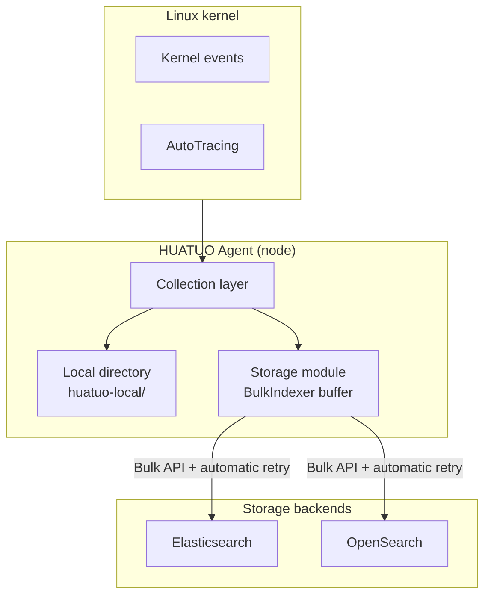

This guide describes write, filter, and batched-query contracts for development and troubleshooting. See [Storage Services](/docs/best-practice/storage_en.md) for deployment and configuration.

## Architecture

Nodes write kernel events to enabled local-file and Elasticsearch or OpenSearch backends. Both remote backends use `[Storage.Elasticsearch]` and are selected by their address.

Remote writes use the Bulk API to submit batches asynchronously.



## Write Flow

Remote writes enqueue events in BulkIndexer. Background workers submit a batch when the byte threshold, time threshold, or process-exit condition is met. Local-file writes are synchronous and independent of the remote Bulk path.

```mermaid
sequenceDiagram
    participant T as Collection layer
    participant L as Local directory (huatuo-local/)
    participant S as Storage module (BulkIndexer)
    participant B as ES / OpenSearch

    T->>S: Collect kernel event and serialize to JSON
    par Local path (synchronous)
        S->>L: Write local file
    and Remote path (asynchronous batches)
        S->>S: Enqueue in Bulk buffer; return immediately
        Note over S: 5 MB / 1 s / exit condition met
        S->>B: POST /_bulk (multiple records)
        B-->>S: 200 OK + per-item results
        Note over S: Log failed items through OnFailure
    end
```

## Bulk Writes

### Buffering and Flushing

| Parameter | Value | Meaning |
|-------------------|---------------------|---------------------------------|
| `FlushBytes` | 5 MB | Flush immediately when buffered bytes reach this threshold |
| `FlushInterval` | 1 s | Force a flush 1 second after the previous flush |
| `NumWorkers` | 4 | Background goroutines submitting concurrent Bulk requests |
| Process exit | `Close(ctx)` | Triggered by SIGTERM/SIGINT; drain buffers within 10 s |

### Failures and Retries

Bulk failures have two levels with different retry scopes:

| Level | Condition | Handling | Retry |
|----------------|-----------------------------------------------------|-------------------------------------------------------------------------------------------------------|----------|
| **Batch failure** | Transport error (connection, timeout, TLS)<br>HTTP `429 / 502 / 503 / 504` | After the initial failure, retry at most **3 times**, waiting 200, 400, and 800 ms before retries; at most 4 requests | Automatic |
| **Batch rejection** | HTTP `400 / 401 / 403 / 404 / 413`, etc. | No retry; discard the entire batch and log through `OnError` | Discard |
| **Item failure** | 200 OK with an item failure: version conflict, mapping error, oversized document | No retry; discard only the failed item and log `index/id/status/type/reason` through `OnFailure` | Discard |
| **Item success** | 200 OK with item success | Primary shard write succeeded; replica failures produce warnings with the index, document ID, and failed shard count | — |

HTTP success does not mean every record was written successfully.

The current client also waits 1600 ms after the final retryable failure before returning, without sending a fifth request. Request cancellation can end the wait early.

### Data Loss Scenarios

Events can still be lost after `Save` returns `nil`:

1. **Abnormal process termination**: `SIGKILL` or host power loss discards unflushed BulkIndexer buffers. A local copy may exist only if the local backend is enabled and its write succeeded.
   - Mitigation: SIGTERM/SIGINT use graceful shutdown, calling `Close` to force a flush with a maximum wait of 10 seconds.
2. **Permanent batch rejection**: 4xx errors other than 429 discard the entire batch. Typical causes include a disabled index, invalid password, or a document exceeding `http.max_content_length`.
   - Diagnosis: `OnError` logs the ES `type` and `reason`.
3. **Permanent item failure**: mapping conflicts, version conflicts, or document syntax errors.
   - Diagnosis: `OnFailure` logs identify the failed record by `index/id`.

Local copies depend on backend enablement, write success, and rotation and retention policies. Their existence does not guarantee recovery after a remote write failure.

## Profiling Window Commit

The IRQ CLI uses the shared profiler runner and single-window Pipeline to send `types.ProfilingWindow` through Toolstream. The handler registered by `internal/profiling.Register` calls `pkg/profiling/store.SaveSync` to save the window. On an error-free commit request, the same handler calls `Store.Commit` to write a durable completion marker.

After remote output succeeds, the tool sends `end + commit` and waits for the daemon's storage and publication ACK. The task succeeds only when the profile is queryable and publication succeeds. Ordinary End, collection failure, and disconnection do not publish a completion marker. If the ACK is lost, results may already be published; callers should query by task ID. See [IRQ Tracing](/docs/best-practice/irqtracing_en.md#invocation-by-huatuo-bamai) for deployment dependencies and upgrade requirements.

## Filter Semantics

The internal storage query API combines filters with AND. SQLite and Elasticsearch use these rules for non-null scalar values:

| Operator | Meaning |
| --- | --- |
| `OpEq`, `OpNe` | Equal/not equal; neither matches missing or null values |
| `OpGt`, `OpGte`, `OpLt`, `OpLte` | Strict or inclusive range comparison |
| `OpIn` | Membership in a nonempty slice or array of scalar values |
| `OpExists`, `OpNotExists` | Presence/absence of a non-null queryable value; leave `Value` unset |

An empty string is literal: `OpEq("")` matches empty strings; `OpNe("")` requires an existing, non-null, nonempty string. Use `OpNotExists` for missing fields; `OpEq("")` does not mean missing. Host profiling queries use `OpNotExists` on `container_hostname`.

Comparison values support Go built-in strings, booleans, integers, and finite floating-point numbers; range comparisons reject booleans. `time.Time` and `timeutil.Timestamp` become UTC strings with nine fractional digits, including in `OpIn`. Nil, pointers, objects, nested collections, and non-finite numbers return `driver.ErrInvalidQuery`. Integer range bounds preserve original JSON precision; supported numeric ranges still depend on the backend and field mapping.

Elasticsearch callers must specify the actual indexed field used for exact comparison: the original field for `keyword` mappings, or an explicitly configured keyword subfield such as `hostname.keyword` for `text` mappings. The backend neither guesses subfields nor ORs text and keyword queries. `OpNe` combines `exists` and `must_not term` on the same field. Full-text matching and whole-array equality are outside this scalar contract.

Elasticsearch existence checks apply to indexed values, not key presence in `_source`. Mapping settings such as `ignore_above`, `null_value`, and normalizers can alter existence or equality behavior. To match SQLite semantics, use mappings that preserve the intended scalar semantics. Date fields cannot be compared with empty strings; use existence operators to express "has a date value."

## Batched Reads

### Parameters

`Query(ctx, query, consume)` invokes callbacks synchronously in order, with at least one record per batch. Callers must supply an explicit total record limit.

| Parameter | Meaning and Constraints |
| --- | --- |
| `Limit` | Total records delivered after skipping `Offset` matches; must be positive |
| `Offset` | Matching records to skip; must be nonnegative |
| `BatchSize` | Records per batch; must be nonnegative. Zero uses the default of 100; each batch is capped by the remaining total allowance |

`storage.Store.Query` validates parameters; backends consume the validated values.

`Count` and `Values` use only `Filters`, ignoring `Sorts`, `Limit`, `Offset`, and `BatchSize`, including zero or negative pagination values.

`Count` counts all matching records. `Values` uses a separate `size`, validated as nonnegative by `storage.Store.Values`. Backends do not repeat pagination or `size` validation for these operations.

Elasticsearch/OpenSearch `Values` preserves integer term keys without converting
them through floating point, including `unsigned_long` values returned by
OpenSearch. String keys remain literal and floating-point terms retain their
existing formatting. Values already rounded by the server (for example after
numeric type promotion across indexes) cannot be recovered by the client.

### Backend Differences

- SQLite reads rows using one SELECT with `LIMIT/OFFSET`. The callback holds the sole database connection and must not synchronously access the same backend again.
- Elasticsearch 7/8 and OpenSearch use Scroll snapshots to read and skip beyond the result window. Deep offsets still require reading and skipping earlier records; separate API requests do not share snapshots.
- Local-file storage does not support queries.

### Callbacks and Cleanup

Each batch owns its data independently. Callback, decoding, or backend errors, and cancellation, terminate the query immediately without rolling back earlier callback effects.

Scroll cleanup uses an independent bounded context and attempts resource release even if the query context is canceled. Queries are not retried automatically because a lost response may already have advanced the Scroll cursor.

## Application Queries

Task recovery reads 1000 Jobs at a time in ascending ID order, closes the read before starting supervision tasks, and continues with an ID cursor to avoid offset-pagination omissions as task states change.

The API supplies pagination defaults only when `limit` is omitted:

| Query | Default Records | Maximum Records | Other Limits |
| --- | --- | --- | --- |
| Job list | 100 | 1000 | Read one extra record to determine `has_more` |
| Raw Profiles | 20 | 100 | Read one extra record to determine `has_more`; response cap of 64 MiB |

Explicit zero, negative, or excessive `limit` values return parameter errors. See the [Profiling API](/docs/reference/profiling-api_en.md) for request and response formats.

Flame graph queries merge Profiles while reading, up to 100000 windows, and read one extra record to detect overflow. Exceeding the limit prompts the caller to narrow the time range or filters; read or merge failures return no partial results.

Input batches can be released after processing, but merged-result memory still grows with the number of distinct stacks.

## Error Semantics

These rules describe Elasticsearch/OpenSearch response handling. HTTP success does not guarantee complete results.

`Query` and `Values` return errors on search timeouts or shard failures. `Query` does not deliver the failed batch, but does not roll back previously consumed batches; `Values` returns no partial results. `Count` returns zero and an error on shard failure. Search timeout errors take precedence over shard failures. Shard errors include the total failed shard count and the first failure's type, reason, and nested cause if available.

After a successful HTTP response, `DeleteByQuery` checks timeout first, then execution failures. It returns the first error while preserving the reported deletion count. A missing index returns zero without error; other HTTP errors return zero and an error. Completed deletions are not rolled back.

Direct writes and deletes retain primary-shard success semantics on replica failure and log available failure details as warnings. Bulk writes also report replica failures without retrying successful primary-shard writes.

HTTP errors include the response status and available Elasticsearch error details. Unrecognized or oversized error bodies are reported verbatim up to 4 KiB, with a truncation marker when needed.

## Kernel Observation Time

Event documents may contain a top-level `kernel_observed_timestamp` in UTC. `observed_timestamp` is user-space observation time; `uploaded_timestamp` is storage write time. None substitutes for another. Older documents and events without kernel time omit the new field; historical data is not migrated automatically. Raw `kernel_observed_ns` is used only for in-process correlation and is not written to new documents.
