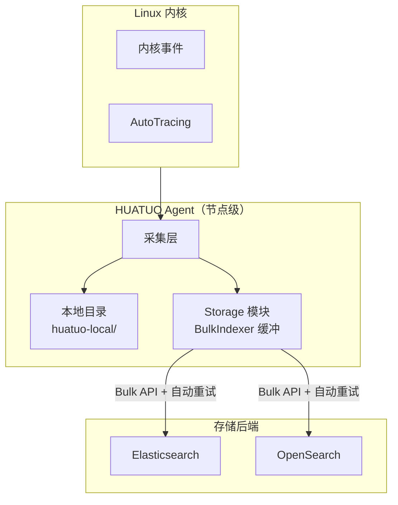
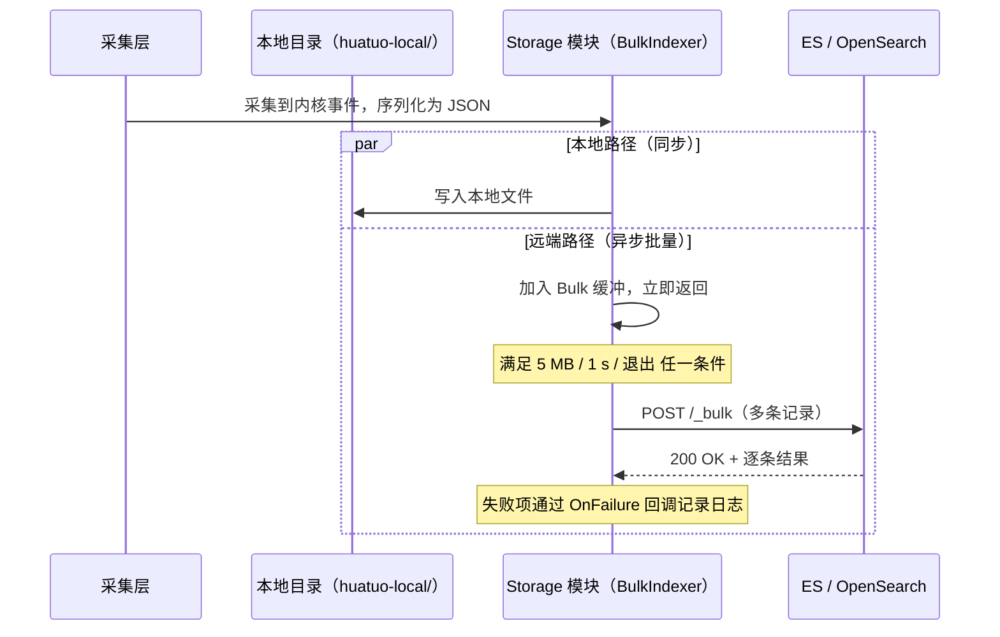

本文说明存储模块的写入、过滤和分批查询契约，供开发和故障排查使用。部署与配置步骤见[存储服务](/docs/best-practice/storage_zh.md)。

## 系统架构

节点按已启用的后端，将内核事件写入本地文件和 Elasticsearch 或 OpenSearch。Elasticsearch 和 OpenSearch 共用同一套 `[Storage.Elasticsearch]` 配置接口，通过地址区分。

远端通过 Bulk API 异步批量写入。

## 数据写入流程

远端批量写入将事件加入 BulkIndexer 缓冲；后台工作协程 在满足"字节阈值 / 时间阈值 / 进程退出"任一条件时将批次提交至远端。本地目录写入是同步落盘，与远端 Bulk 路径相互独立。

## Bulk 批量写入

### 缓冲与刷新

| 参数              | 值                  | 含义                            |
|-------------------|---------------------|---------------------------------|
| `FlushBytes`      | 5 MB                | 缓冲累计达到该字节数立即刷新     |
| `FlushInterval`   | 1 s                 | 距上次刷新满 1 秒后强制刷新      |
| `NumWorkers`      | 4                   | 并发提交 Bulk 请求的后台 goroutine 数 |
| 进程退出          | `Close(ctx)`        | SIGTERM/SIGINT 触发，限时 10 s 内排空缓冲 |

### 失败与重试

Bulk 请求的失败语义分为两层，重试范围不同：

| 层级           | 触发条件                                            | 处理方式                                                                                              | 是否重试 |
|----------------|-----------------------------------------------------|-------------------------------------------------------------------------------------------------------|----------|
| **整批失败**   | 传输错误（连接失败、超时、TLS） HTTP 状态：`429 / 502 / 503 / 504` | 首次请求失败后最多重试 **3 次**，重试前分别等待 200、400、800 ms；最多发送 4 次请求                              | 自动 |
| **整批拒绝**   | HTTP 状态：`400 / 401 / 403 / 404 / 413` 等          | 不重试，丢弃整批记录，并通过 `OnError` 写错误日志                                              | 丢弃 |
| **单条失败**   | 200 OK 但 单条记录失败：版本冲突、字段映射错误、文档过大 | 不重试，仅丢弃失败记录，通过 `OnFailure` 回调记录 `index/id/status/type/reason`                          | 丢弃 |
| **单条成功**   | 200 OK 且 单条记录成功                              | 主分片写入成功；副本失败时记录包含索引、文档 ID 和失败分片数的警告日志                                    | —        |

HTTP 成功不代表所有记录均写入成功。

当前客户端在最后一次可重试失败后还会等待 1600 ms 再返回，但不会发送第五次请求；请求取消可提前结束等待。

### 数据丢失场景

`Save` 返回 `nil` 后，事件仍可能因以下原因丢失：

1. **进程异常退出**：`SIGKILL` 或宿主机断电时，BulkIndexer 内存缓冲尚未刷新的部分直接丢失（仅在本地后端已启用且写入成功时可能保留副本）。
   - 缓解：SIGTERM/SIGINT 走优雅退出路径，退出时调用 `Close` 强制刷新，最长等待 10 秒。
2. **整批被永久拒绝**：4xx（非 429）类错误一次性丢弃整批所有记录。常见诱因：索引被禁用、密码失效、单条文档超过集群 `http.max_content_length`。
   - 排查：`OnError` 错误日志包含 ES 返回的 `type` 与 `reason`。
3. **单条永久失败**：字段映射冲突、版本冲突、文档语法错误。
   - 排查：`OnFailure` 错误日志按 `index/id` 定位失败记录。

本地副本取决于后端是否启用、写入是否成功，以及轮转和保留策略。远端写入失败后，不会据此保证数据可恢复。

## Profiling 窗口提交

IRQ 采集 CLI 接入公共 profiler runner 和单窗口 Pipeline，通过 Toolstream 发送 `types.ProfilingWindow`。`internal/profiling.Register` 注册的处理器调用 `pkg/profiling/store.SaveSync` 保存窗口；同一处理器在提交请求无错误时调用 `Store.Commit`，写入持久化完成标记。

远端输出成功后，工具发送 `end + commit`，并等待守护进程返回存储和发布结果 ACK。只有 profile 已可查询且发布成功，采集任务才成功。普通 End、采集失败和断连均不发布任务完成标记。ACK 丢失时结果可能已发布，调用方应按任务 ID 查询确认。部署依赖及升级要求见 [IRQ 追踪](/docs/best-practice/irqtracing_zh.md#由-huatuo-bamai-调用)。

## 过滤条件语义

内部存储查询 API 使用 AND 组合过滤条件。SQLite 和 Elasticsearch 对非 null
标量值采用以下约定：

| 操作符 | 含义 |
| --- | --- |
| `OpEq`、`OpNe` | 相等／不等；缺失和 null 值均不匹配 |
| `OpGt`、`OpGte`、`OpLt`、`OpLte` | 严格／包含边界的范围比较 |
| `OpIn` | 属于非空切片或数组中的标量值 |
| `OpExists`、`OpNotExists` | 存在／不存在非 null 的可查询值；不设置 `Value` |

空字符串是字面值：`OpEq("")` 匹配空字符串；`OpNe("")` 要求字符串存在、非 null
且非空。查询缺失字段应使用 `OpNotExists`，`OpEq("")` 不表示字段缺失。
主机 profiling 查询使用 `container_hostname` 的 `OpNotExists`。

比较值支持 Go 内建字符串、布尔、整数及有限浮点数，范围比较不接受布尔值。
`time.Time` 和 `timeutil.Timestamp` 统一转为保留九位小数的 UTC 字符串，
`OpIn` 元素也采用相同规则。nil、指针、对象、嵌套集合及非有限数值返回
`driver.ErrInvalidQuery`。整数范围边界保留原始 JSON 精度，实际支持的数值范围
仍受后端和字段映射约束。

Elasticsearch 调用方必须指定实际用于精确比较的索引字段：`keyword` 映射使用
原字段；`text` 映射使用明确配置的 keyword 子字段，例如 `hostname.keyword`。
后端不会猜测子字段，也不会将 text 与 keyword 查询进行 OR 组合。
`OpNe` 对同一字段执行 `exists` 和 `must_not term`。全文匹配和数组整体相等
不属于这里的标量比较约定。

Elasticsearch 的存在性判断针对索引值，而不是 `_source` 中是否包含键。
`ignore_above`、`null_value` 和 normalizer 等映射设置可能改变存在性或相等行为。
要求与 SQLite 一致时，应使用保留目标标量语义的映射。日期字段不能与空字符串
比较；表达“已有日期值”时应使用存在性操作符。

## 分批读取

### 参数

`Query(ctx, query, consume)` 按顺序同步调用回调，每批至少一条记录。调用方必须明确指定总条数上限。

| 参数 | 含义与约束 |
| --- | --- |
| `Limit` | 跳过 `Offset` 条匹配记录后，交给回调的总条数上限；必须大于零 |
| `Offset` | 跳过的匹配记录数；必须非负 |
| `BatchSize` | 每批条数；必须非负，零使用默认值 100，每批不超过剩余总限额 |

`storage.Store.Query` 统一校验参数，后端只消费已校验的值。

`Count` 和 `Values` 只使用 `Filters`，忽略 `Sorts`、`Limit`、`Offset` 和 `BatchSize`，包括零值及负数分页参数。

`Count` 统计全部匹配记录；`Values` 使用独立的 `size`，由 `storage.Store.Values` 校验其非负约束。后端不重复校验这两个操作的分页参数或 `size`。

### 后端差异

- SQLite 使用一条带 `LIMIT/OFFSET` 的 SELECT 逐行读取。回调期间占用唯一数据库连接，回调不能同步再次访问同一后端。
- Elasticsearch 7/8 和 OpenSearch 使用 Scroll 快照，支持跨越结果窗口的读取和偏移。深偏移仍需读取并跳过前面的记录，不同 API 请求不共享快照。
- 本地文件存储不支持查询。

### 回调与资源释放

各批次独立持有数据。回调、解码、后端错误或取消都会立即终止查询，已执行回调的效果不会回滚。

Scroll 使用独立的有界上下文清理，即使原查询已取消也会尝试释放资源。查询不自动重试，因为丢失响应时 Scroll 游标可能已经前进。

## 业务查询

任务恢复按 ID 升序每批读取 1000 个 Job，读取关闭后再启动监督任务。后续查询使用 ID 游标，避免任务状态变化导致偏移分页漏读。

API 分页仅在未传 `limit` 时填默认值：

| 查询 | 默认条数 | 最大条数 | 其他限制 |
| --- | --- | --- | --- |
| Job 列表 | 100 | 1000 | 每页额外读取一条判断 `has_more` |
| 原始 Profile | 20 | 100 | 每页额外读取一条判断 `has_more`；响应上限 64 MiB |

显式传入零值、负数或超过上限的 `limit` 返回参数错误。请求和响应格式见 [Profiling API](/docs/reference/profiling-api_zh.md)。

火焰图查询边读取边合并 Profile，最多处理 100000 个窗口，并额外读取一条检测超限。超限时提示缩小时间范围或过滤条件；读取或合并失败不返回部分结果。

输入批次处理后可释放，但合并结果的内存仍随不同调用栈数量增长。

## 错误语义

以下说明 Elasticsearch/OpenSearch 的响应处理。HTTP 成功不代表结果完整。

`Query` 和 `Values` 在搜索超时或分片失败时返回错误，
`Query` 不交付失败批次，但此前已消费的批次不会回滚；`Values` 不返回部分结果。
`Count` 在分片失败时返回零和错误。搜索超时优先于分片失败返回。
分片错误包含失败分片总数，以及首条失败的类型、原因及嵌套原因（如果存在）。

收到成功 HTTP 响应后，`DeleteByQuery` 按超时、执行失败的顺序检查，
遇到首个错误即返回，同时保留响应中的已删除数量。
索引不存在时返回零且不报错，其他 HTTP 错误返回零和错误。
已完成的删除不会回滚。

直接写入和删除在副本失败时保留主分片操作成功的语义，
通过警告日志记录可用的失败详情。Bulk 写入也会报告副本失败，不重试已经成功的主分片写入。

HTTP 错误包含响应状态码和可用的 Elasticsearch 错误详情。无法识别或过大的错误响应体
以原文报告，限制为 4 KiB，并在截断时追加标记。

## 内核观测时间

事件文档可包含顶层 `kernel_observed_timestamp`，其值为 UTC 日期时间。
`observed_timestamp` 是用户态观测时刻，`uploaded_timestamp` 是存储写入时刻。
三者不互相补填。旧文档及没有内核时间的事件省略新增字段；历史数据不自动迁移。
原始 `kernel_observed_ns` 仅用于进程内事件关联，不写入新文档。
